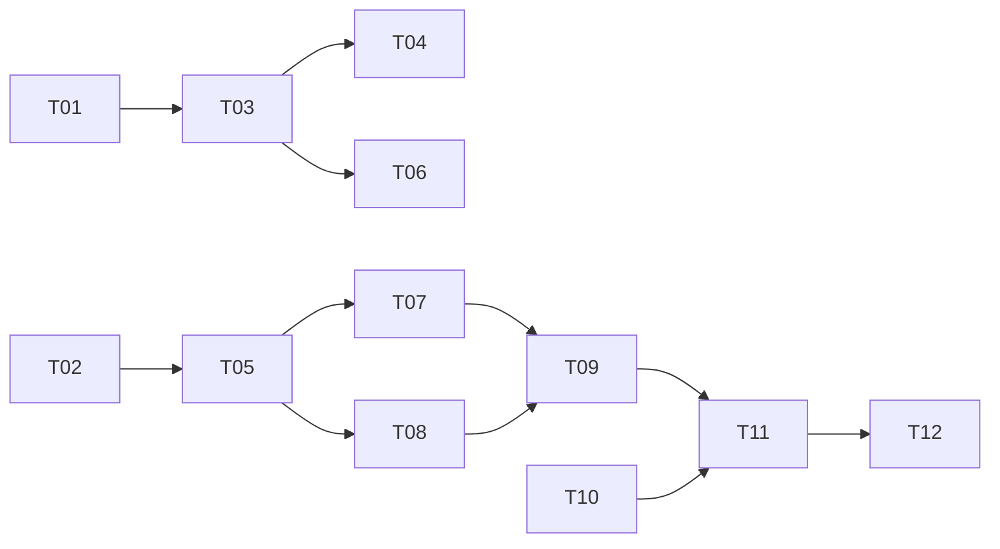

# Schedule, Dependencies and Budget: CampusHelp

Project period: 17 Nov 2026 to 30 Nov 2026 (10 working days, Monday to Friday only).

## 1. Task schedule and dependencies

| Task | Name | Owner | Start | Due | Effort (h) | Depends on |
|---|---|---|---|---|---|---|
| T01 | Develop project charter | A | 17 Nov | 17 Nov | 4 | None |
| T02 | Gather stakeholder requirements | B | 17 Nov | 18 Nov | 4 | None |
| T03 | Prepare scope and WBS | C | 18 Nov | 18 Nov | 4 | T01 |
| T04 | Prepare schedule, dependencies and budget | A | 19 Nov | 20 Nov | 4 | T03 |
| T05 | Design initial wireframes | B | 19 Nov | 19 Nov | 4 | T02 |
| T06 | Develop risk register and quality plan | C | 19 Nov | 20 Nov | 4 | T03 |
| T07 | Create student request interface prototype | B | 20 Nov | 23 Nov | 4 | T05 |
| T08 | Create administrator dashboard prototype | A | 20 Nov | 23 Nov | 4 | T05 |
| T09 | Prepare and execute prototype tests | C | 24 Nov | 25 Nov | 4 | T07, T08 |
| T10 | Evaluate and document change request | A | 24 Nov | 26 Nov | 3 | None (request arrives on Day 6) |
| T11 | Perform final verification and issue review | C | 27 Nov | 27 Nov | 3 | T09, T10 |
| T12 | Consolidate final report and closure | B | 30 Nov | 30 Nov | 3 | T11 |

## 2. Dependency diagram

## 3. Critical path

The longest chain of dependent tasks is:

T02 > T05 > T07 or T08 > T09 > T11 > T12

If any task on this chain is late, the final report (T12) is late. T01, T03, T04 and T06 have some slack because nothing in the final chain depends on them.

## 4. Tasks with high delay risk

| Task | Why it may be delayed | Effect | Action |
|---|---|---|---|
| T02 Gather stakeholder requirements | Depends on stakeholders answering on time. Answers may be late or unclear. | T05, T07, T08, T09 all wait for it. | Send questions on Day 1 and set a reply deadline. Use the assumptions in the charter if no reply arrives. |
| T07 and T08 Prototypes | Two prototypes are built in parallel and both need the wireframes from T05. Design changes are likely. | T09 cannot start. | Freeze the wireframes after T05 review. Keep the prototypes simple (static screens). |
| T10 Change request | The request arrives on Day 6, in the middle of the testing phase, and the impact is not known in advance. | T11 waits for the decision. | Keep 3 h of buffer. Decide Approve, Reject or Defer by 26 Nov. |

## 5. Budget

Estimating rule: cost = hours x 50,000 UZS per person-hour.

| Item | Hours | Cost (UZS) |
|---|---|---|
| Student A (T01, T04, T08, T10) | 15 | 750,000 |
| Student B (T02, T05, T07, T12) | 15 | 750,000 |
| Student C (T03, T06, T09, T11) | 15 | 750,000 |
| **Total** | **45** | **2,250,000** |

Notes:

- Hours are the planned total: nine tasks at 4 h and three tasks at 3 h give 36 + 9 = 45 h.
- No software, hosting or other external costs are planned.
- If the change request (T10) is approved, it adds a provisional 3 h (150,000 UZS), which would be reported separately from the base budget.
- Actual hours are tracked in the GitHub Project (Actual Hours field) and compared with these estimates at each status update.
