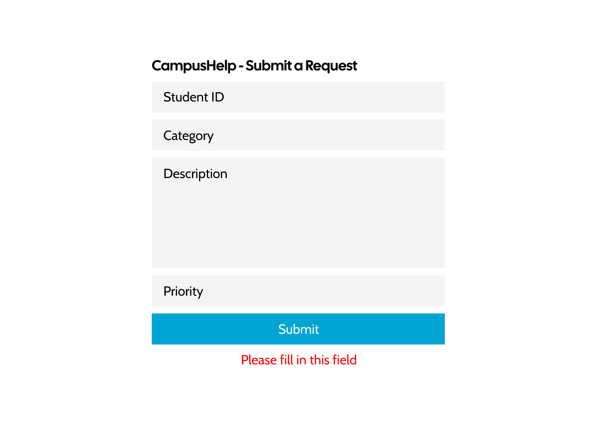
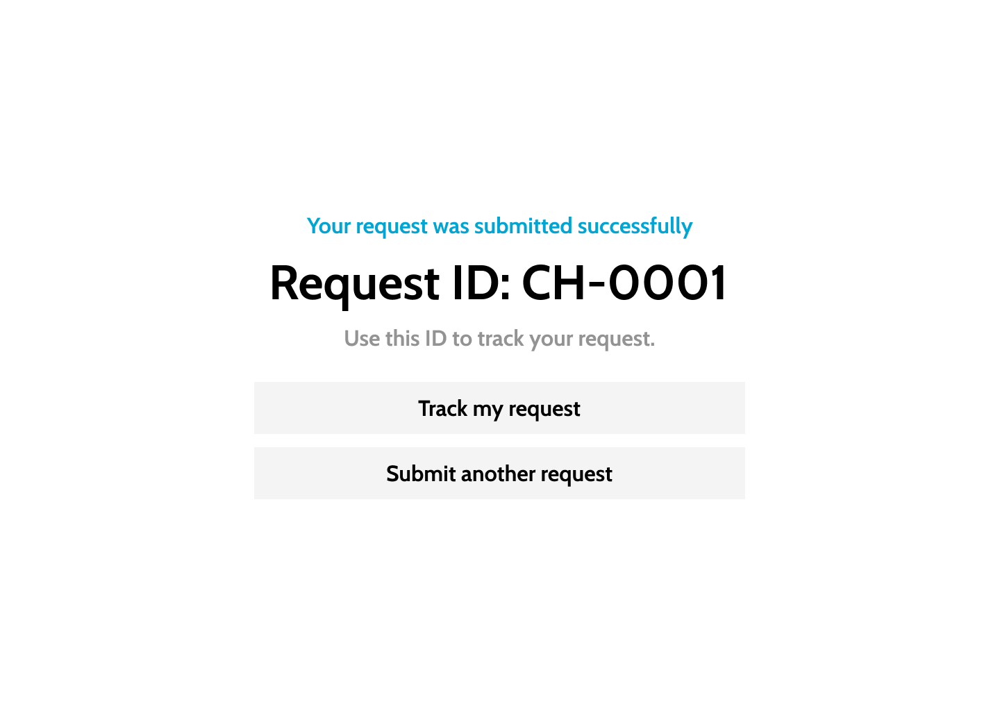
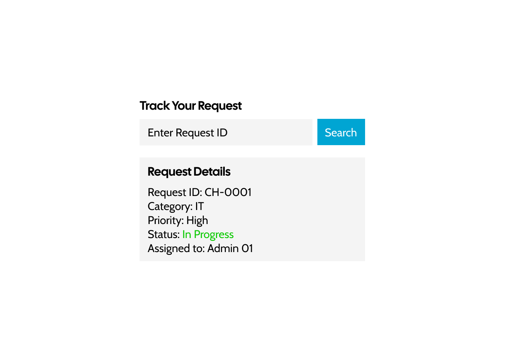
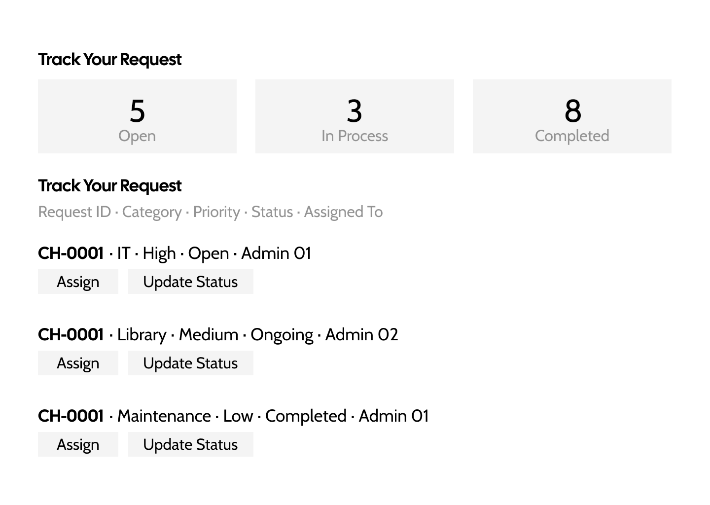

# CampusHelp - Wireframes

**Related task:** T05 - Design initial wireframes

## Screen 1: Request Form

Students enter their Student ID, choose a category and priority, write a description and click Submit. Empty required fields show an error message.

## Screen 2: Confirmation

After submitting, the student sees a success message and a unique request ID.

## Screen 3: Track Request

The student enters the request ID and sees the current status and the person assigned.

## Screen 4: Admin Dashboard

The administrator sees the number of open, ongoing and completed requests, and can assign a request or update its status.

## Categories and Priority Levels

**Categories:** IT support, Classroom maintenance, Library assistance, Administrative services.

**Priority levels:** High, Medium, Low.
